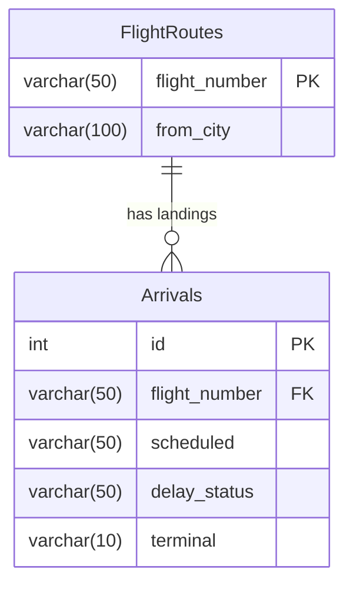

# Flight Arrivals Management System (`JDBC_FlightManager`)

**Course:** Software Engineering Methods (Academic Year 2026–2027)  
**Institution:** Braude College of Engineering | Department of Software Engineering  
**Database Engine:** MySQL 8.0+ | **Language:** Java 25 LTS (JDBC)

---

## 1. Project Description
`JDBC_FlightManager` is the Data Access Layer (DAL) of an airport flight arrivals management system.
Raw landing data (`arrived_flights.csv`, 299 records) is imported into MySQL as a flat table (`rawflights`),
analyzed for functional dependencies, and decomposed into Third Normal Form (3NF) as two related tables:
`FlightRoutes` and `Arrivals`. On top of this schema, the project implements JDBC operations with the help of a
local AI assistant (Continue + Qwen2.5-Coder-7B-Instruct):

| Class | Purpose |
| :--- | :--- |
| `FlightManagerBase` | Connects to `FlightDB` and prints the full arrivals board (INNER JOIN of both tables). |
| `SimpleFlightUpdater` | Updates the status of flight `LX354`. Originally written with a vulnerable `Statement` (string concatenation) to demonstrate SQL Injection, then refactored into a secure `PreparedStatement`. |
| `AdvancedFlightDispatcher` | Updates several arrivals at once (IDs 1, 3, 5 → `Landed - Final`) using a single batched `PreparedStatement` (`addBatch` / `executeBatch`). |
| `FlightViewer` | Shows all arrivals of a chosen terminal (2–5), sorted by scheduled time, using a parameterized INNER JOIN query. |

The project also demonstrates a live SQL Injection attack (`Landed' #`) that overwrote all 299 rows, and its
remediation using pre-compiled parameterized queries.

---

## 2. Engineering Team Details (Single-Workstation Driver–Navigator)

| Role | Full Name | Student ID | Braude Academic Email |
| :--- | :--- | :--- | :--- |
| **Student A** | Jiryes Daood | 213559677 | jiryes.daood@e.braude.ac.il |
| **Student B** | Adam Zayyad | 325488559 | adam.zayyad@e.braude.ac.il |

* **Group Number:** `G14`
* **GitHub Repository URL:** `https://github.com/jiryesDaood/JDBC_FlightManager`

---

## 3. Technology Stack
* **Runtime & JDK:** BellSoft Liberica Full JDK 25 LTS
* **Database Server:** MySQL Server 8.0+ (`FlightDB` schema)
* **JDBC Driver:** MySQL Connector/J 9.5.0 (`mysql-connector-j-9.5.0.jar`)
* **IDE & Database Tooling:** IntelliJ IDEA Ultimate (Built-in Database Console & SQL Generator)
* **Local AI Assistant:** LM Studio (`Qwen2.5-Coder-7B-Instruct`) integrated via the Continue plugin
* **Version Control:** Git & GitHub

---

## 4. Database Normalization (3NF) & Functional Dependencies ($F$)

### 4.1 Functional Dependencies ($F$) in `rawflights`
The raw table is `rawflights(scheduled, flight, fromC, delay, terminal)`.

* $\text{flight} \rightarrow \text{fromC}$ — a flight number uniquely determines its departure city.
* A single landing event is identified by the flight together with its schedule
  ($\{\text{flight}, \text{scheduled}\} \rightarrow \{\text{delay}, \text{terminal}\}$). The same flight number
  can land on different dates/schedules, so `flight` alone is **not** a candidate key of a landing row.

### 4.2 Why `rawflights` Violated 3NF
`fromC` depends only on `flight`, which is just part of what identifies a landing row and not a key on its own.
The city is therefore stored again for every landing of the same flight (redundancy), which causes three anomalies:

* **Update anomaly:** changing a route's departure city requires updating every landing row of that flight;
  missing one leaves the data inconsistent.
* **Insertion anomaly:** a new flight route (flight number + city) cannot be recorded until at least one
  landing of it actually happens.
* **Deletion anomaly:** deleting the landing history of a flight also deletes the only record that the route
  (and its departure city) exists.

### 4.3 Decomposed 3NF Relational Schema
* **`FlightRoutes`** (parent)
  * `flight_number VARCHAR(50)` — **PRIMARY KEY**
  * `from_city VARCHAR(100) NOT NULL`
* **`Arrivals`** (child)
  * `id INT AUTO_INCREMENT` — **PRIMARY KEY**
  * `flight_number VARCHAR(50) NOT NULL` — **FOREIGN KEY** → `FlightRoutes(flight_number)` `ON DELETE CASCADE`
  * `scheduled VARCHAR(50)`
  * `delay_status VARCHAR(50)`
  * `terminal VARCHAR(10)`

Each departure city is now stored once per route, and every landing references its route through the foreign key.

---

## 5. Independent AI Prompt (Part 4 – `FlightViewer.java`)

```text
Write a complete Java class named FlightViewer with a main method.
Use a Scanner to ask the user for the MySQL root password, then connect to the FlightDB database with DriverManager using URL "jdbc:mysql://localhost:3306/FlightDB?allowLoadLocalInfile=true&allowPublicKeyRetrieval=true&serverTimezone=Asia/Jerusalem&useSSL=false" and user "root".
Then ask the user to enter a terminal number (valid terminals are 2, 3, 4, 5).
Use try-with-resources for the Connection, the PreparedStatement and the ResultSet.
Use a secure PreparedStatement with a '?' placeholder to run this query:
SELECT a.id, a.flight_number, r.from_city, a.scheduled, a.delay_status, a.terminal FROM Arrivals a INNER JOIN FlightRoutes r ON a.flight_number = r.flight_number WHERE a.terminal = ? ORDER BY a.scheduled ASC
The terminal column is VARCHAR(10), so bind the parameter with pstmt.setString(1, terminal), not setInt.
Print the results as a formatted table with the columns ID, Flight, From, Scheduled, Status and Terminal using System.out.printf, and print the total number of flights found at the end.
Handle SQLException by printing a clear error message.
```

---

## 6. Entity Relationship Diagram (ERD)



---

## 7. Security Audit Summary (Part 5 – SQL Injection Mitigation)
* **Attack Payload Tested:** `Landed' #`
* **Vulnerability Analysis (`Statement`):** The original `SimpleFlightUpdater` built its SQL by concatenating the
  user's input directly into the command text:
  `"UPDATE Arrivals SET delay_status = '" + userInput + "' WHERE flight_number = 'LX354'"`.
  With the payload, the server received
  `UPDATE Arrivals SET delay_status = 'Landed' #' WHERE flight_number = 'LX354'`.
  The single quote (`'`) closed the string literal early, and `#` started a MySQL single-line comment, so the
  entire `WHERE` clause was ignored. The statement became `UPDATE Arrivals SET delay_status = 'Landed'`, and
  **all 299 rows** were overwritten.
* **Remediation (`PreparedStatement`):** The class was refactored to
  `UPDATE Arrivals SET delay_status = ? WHERE flight_number = ?` with values bound via `setString`. The query is
  compiled by the server *before* any user data is supplied, so its structure, including the `WHERE` clause,
  cannot be changed. Bound values are sent strictly as data (literals) and are never parsed as SQL. Re-running the
  same payload updated **exactly 1 row** (`LX354`), whose status was stored literally as `Landed' #`, while the
  other 298 flights remained untouched.

---

## 8. License
Distributed under the **Braude College Academic License** (Software Engineering Methods, 2026–2027).
